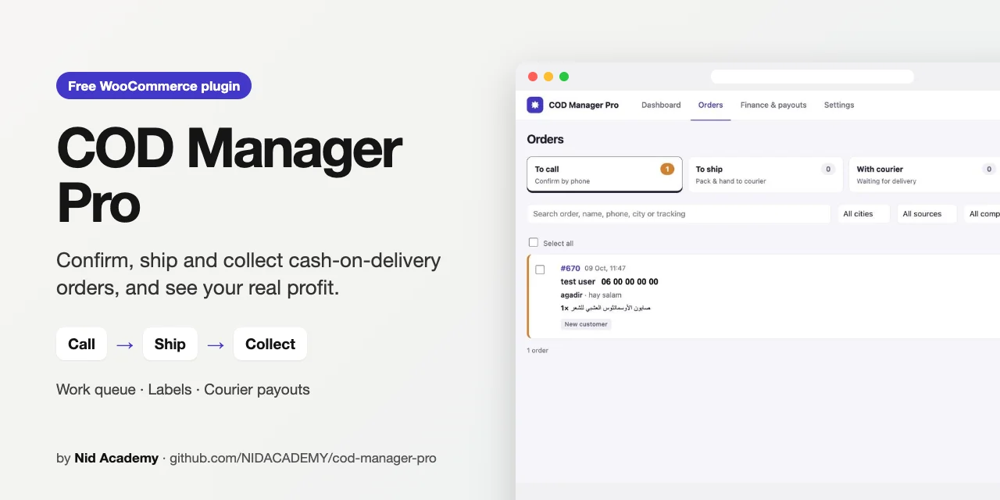
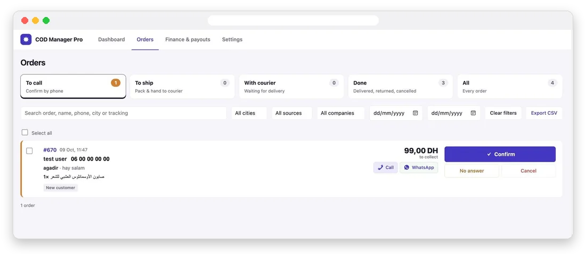
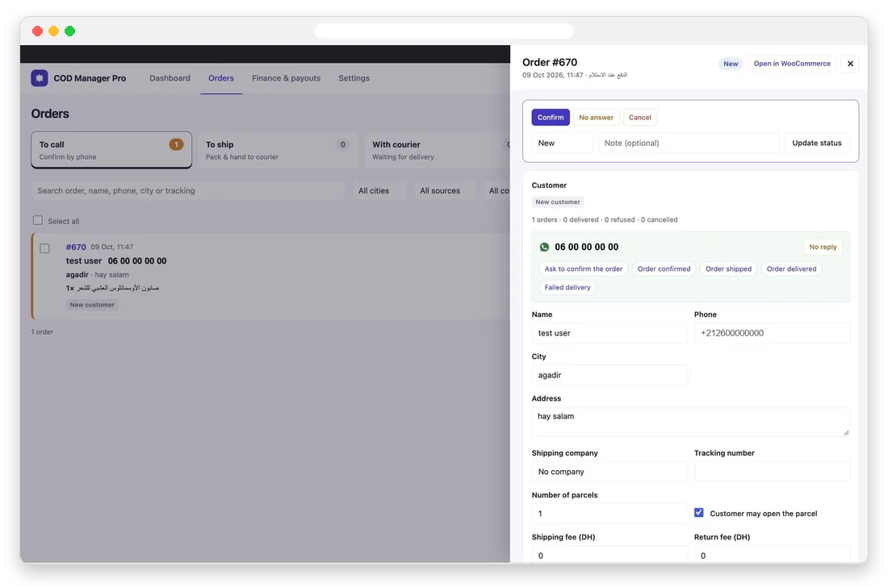
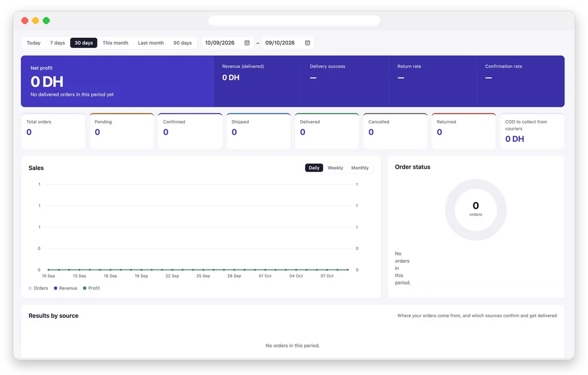
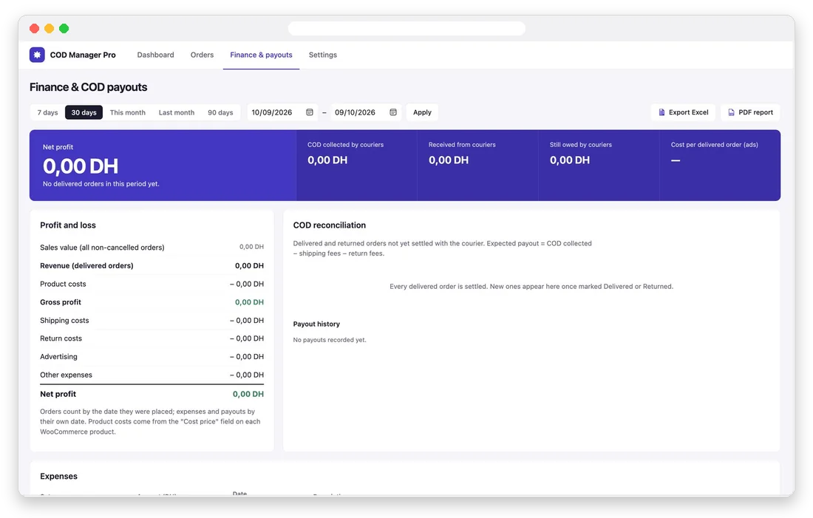
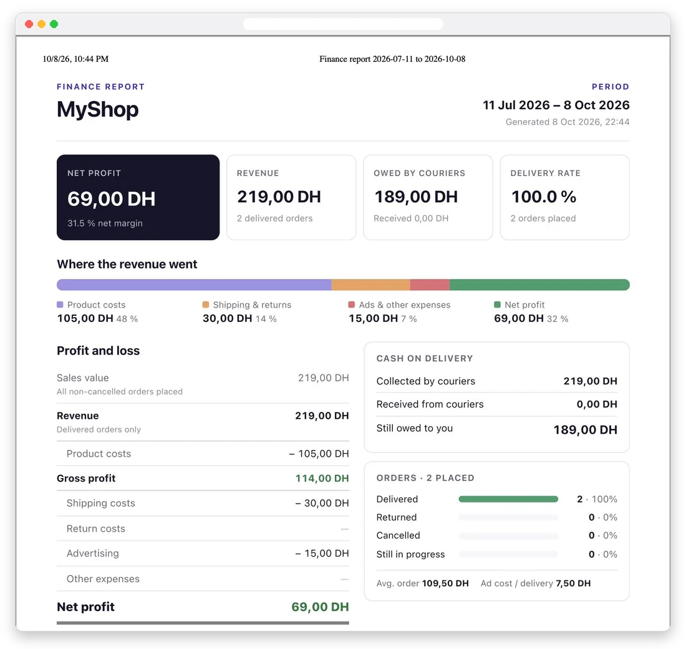

<p align="center">
  
</p>

<p align="center">
  <a href="https://github.com/NIDACADEMY/cod-manager-pro/releases/latest"></a>
  <a href="LICENSE"></a>
  
  
  
  
</p>

<p align="center">
  <a href="https://www.youtube.com/@Nid.Academy"></a>
  <a href="https://www.instagram.com/nidacademy_/"></a>
  <a href="https://www.facebook.com/nidacademy1"></a>
</p>

<p align="center">
  <a href="https://www.cod-theme.com">Live demo</a> ·
  <a href="#-download">Download</a> ·
  <a href="#-how-it-works">How it works</a> ·
  <a href="#-screenshots">Screenshots</a> ·
  <a href="#-features">Features</a> ·
  <a href="#-install">Install</a> ·
  <a href="#-updates">Updates</a> ·
  <a href="#-follow-nid-academy">Follow</a>
</p>

---

**COD Manager Pro** is a free WooCommerce plugin for stores that sell with **cash on delivery**. It turns your orders into one simple daily routine (call, ship, collect), so your team always knows the next step and you always know your real profit.

## ⬇ Download

**[Download cod-manager-pro.zip](https://github.com/NIDACADEMY/cod-manager-pro/releases/latest/download/cod-manager-pro.zip)** (latest release), then upload it in **Plugins → Add New → Upload Plugin**.

**[See the live demo store](https://www.cod-theme.com)**: a COD Store shop that runs COD Manager Pro behind the scenes.

## ⚙ How it works

```
 New order  ──▶  To call (confirm by phone or WhatsApp)  ──▶  To ship (label + courier)  ──▶  With courier  ──▶  Delivered / Returned  ──▶  Courier pays you
```

Statuses stay in sync with WooCommerce in both directions. Stock is kept while orders are on their way and put back on returns.

## 🖼 Screenshots

<table>
  <tr>
    <td colspan="2"><br><b>Orders</b>: four tabs (To call, To ship, With courier, Done) with one-click Call, WhatsApp, Confirm, No answer and Cancel.</td>
  </tr>
  <tr>
    <td width="50%"><br><b>Order panel</b>: customer history, WhatsApp templates, shipping company and tracking.</td>
    <td width="50%"><br><b>Dashboard</b>: net profit, delivery and return rates, sales chart and results by source.</td>
  </tr>
  <tr>
    <td><br><b>Finance & payouts</b>: profit and loss, courier reconciliation, expenses, Excel export.</td>
    <td><br><b>PDF report</b>: a clean report with your store name, ready to share.</td>
  </tr>
</table>

<sub>Screenshots use test orders.</sub>

## ✨ Features

| | |
|---|---|
| 📋 **A work queue, not a list** | Four tabs show your team exactly what to do next. |
| 📞 **Call or WhatsApp in one tap** | Ready-made message templates, notes and the full order history. |
| 🏷 **Shipping labels** | 10×15 cm thermal or A4 labels with a barcode, one by one or in bulk. |
| 💰 **Real profit** | Cost price per product and variation, expenses (ads, packaging, salaries), profit per order. |
| 🚚 **Courier money** | What each shipping company still owes you, payouts received and differences. |
| 📊 **Reports** | Excel export (5 sheets) and a print-ready PDF report. |
| 🛡 **Fewer fake orders** | Customers recognised by phone, risk levels, blacklist, duplicate alerts and optional checkout checks. |
| 👥 **Built for teams** | "COD Agent" role: agents confirm orders without seeing revenue, costs or exports. |
| 📣 **Marketing sources** | See which ads (Facebook, Instagram, TikTok, Google...) bring confirmed and delivered orders. |
| 🌍 **Languages** | English, French and Arabic included. |
| 🔄 **Updates itself** | New releases show under Dashboard → Updates. |

## 🚀 Install

1. [Download `cod-manager-pro.zip`](https://github.com/NIDACADEMY/cod-manager-pro/releases/latest/download/cod-manager-pro.zip).
2. In WordPress, go to **Plugins → Add New → Upload Plugin**, choose the zip, then **Install Now** and **Activate**. WooCommerce must be active.
3. **COD Manager Pro → Settings → Shipping companies**: add your couriers with their delivery and return fees.
4. **Products**: fill in "Cost price" on each product so profit is calculated.
5. **Settings → General**: store phone and address (printed on shipping labels).
6. **Settings → Tools**: import your recent WooCommerce orders.
7. **Users**: give confirmation agents the "COD Agent" role.

**Requirements:** WordPress 6.2+, WooCommerce 8.0+, PHP 7.4+.

## 🔄 Updates

New versions appear under **Dashboard → Updates** like any other plugin. You can turn on auto-updates on the Plugins page. See the [changelog](CHANGELOG.md).

## 🧩 For developers

- Actions: `codm_order_created`, `codm_order_status_changed`, `codm_order_removed`.
- Filters: `codm_check_order`, `codm_order_initial_status`, `codm_whatsapp_providers`, `codm_carriers`.
- Interfaces: `CODM_WhatsApp_Provider`, `CODM_Carrier`.

Using your own order form instead of the WooCommerce checkout? See the FAQ in `readme.txt`.

## 🤝 Works well with

- **[COD Store](https://github.com/NIDACADEMY/cod-store)**: our free cash-on-delivery theme for WooCommerce, with the order form on the product page.

## 🌐 External services

COD Manager Pro does not send your orders anywhere. WhatsApp buttons open wa.me links in your own browser, and the plugin checks GitHub for new releases. Details are in `readme.txt`.

## 📣 Follow Nid Academy

Tutorials, tips and new releases:

<p>
  <a href="https://www.youtube.com/@Nid.Academy"></a>
  <a href="https://www.instagram.com/nidacademy_/"></a>
  <a href="https://www.facebook.com/nidacademy1"></a>
</p>

Found a bug or have an idea? [Open an issue](https://github.com/NIDACADEMY/cod-manager-pro/issues).

## 📄 License

GPL-2.0-or-later. See [LICENSE](LICENSE).

<p align="center"><sub>Made with care by <a href="https://www.nidacademy.org/">Nid Academy</a></sub></p>
